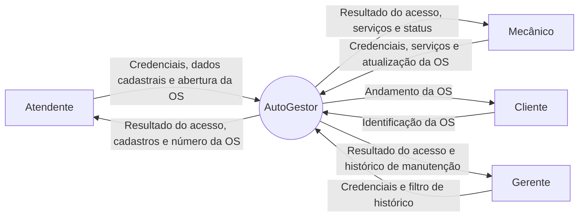
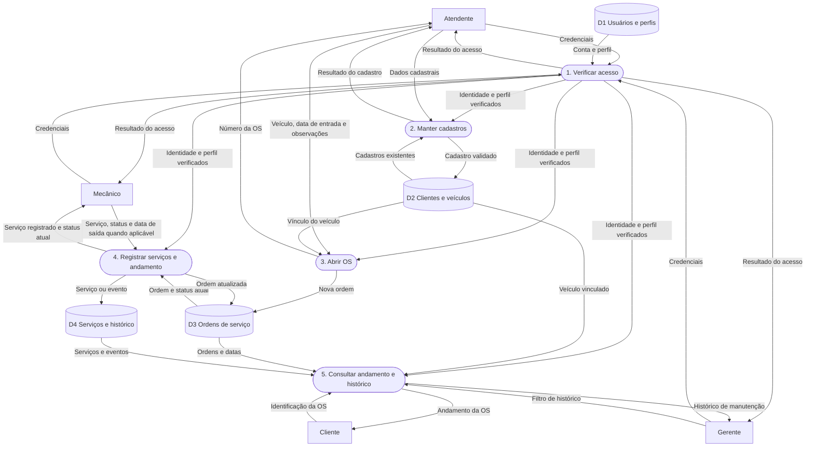

# AutoGestor — Exercício 4

## 1. Revisão intermediária

A revisão usa o README e o [Exercício 2](AutoGestor_Exercicio2_Arquitetura_UML.md) no commit `cc285d69c3f7a7644131458890e89c372891d22f`. A devolutiva específica do professor está pendente. Foram mantidos o cadastro de clientes e veículos, as ordens de serviço (OS), as datas de entrada e saída, o acompanhamento e o histórico. A autenticação e o banco de dados constam no planejamento do E2.

## 2. Diagrama de contexto

## 3. DFD nível 0

O diagrama propõe que a consulta do cliente retorne somente os dados da OS que ele estiver autorizado a consultar. O mecanismo de comprovação desse vínculo precisa ser definido antes de implementar a consulta.

## 4. Dicionário de dados

| Item | Campos ou formato | Uso e regras |
|---|---|---|
| Cliente | id inteiro, nome, telefone e e-mail em texto | Identifica o proprietário. Nome obrigatório. |
| Veículo | id, cliente_id, placa, modelo, ano | Placa única. Cliente existente. Ano em quatro dígitos. |
| Ordem de serviço | id, veiculo_id, entrada, saída opcional, status, observações | Veículo existente. Saída igual ou posterior à entrada. |
| Serviço | id, os_id, descrição, valor decimal | Ordem existente, descrição preenchida e valor não negativo. |
| Status da OS | Aberta, Em andamento, Concluída | Valores propostos para acompanhar a ordem. |
| Evento de status | os_id, status, data e hora, usuário_id | Registra a mudança e seu responsável. |
| Conta de acesso | id, usuário, hash da senha, perfil | Usuário único. Perfil de gerente, atendente ou mecânico. |
| Consulta de andamento | identificador da OS e comprovação de vínculo | Retorna apenas os dados autorizados da ordem. |
| Filtro de histórico | veículo e intervalo de datas opcional | Seleciona ordens e serviços do veículo. |
| Histórico de manutenção | ordens, datas, serviços, valores e eventos | Apresenta os atendimentos em ordem cronológica. |

## 5. Comparação com a implementação

A branch `main`, na revisão indicada na seção 1, contém README e documentos do projeto. Não há código da interface, da API ou do banco de dados. O DFD e o dicionário foram comparados com os requisitos e a modelagem versionados. Os fluxos de cadastro, abertura e atualização de OS e histórico têm respaldo no E2. Autenticação, persistência e regras de consulta ainda precisam de validação em um protótipo executável.

## 6. Relatório de ajustes

Foram incluídos os fluxos de acesso e as datas de entrada e saída. O histórico passou a indicar a ligação entre veículo, ordem, serviço e mudança de status. Os depósitos representam os grupos de dados previstos na arquitetura do E2. O modelo define os campos e regras que precisam ser conferidos quando a implementação estiver disponível.

## 7. Registro no repositório

Esta página registra o diagrama de contexto, o DFD nível 0, o dicionário e o relatório de ajustes do E4 no histórico do AutoGestor.
